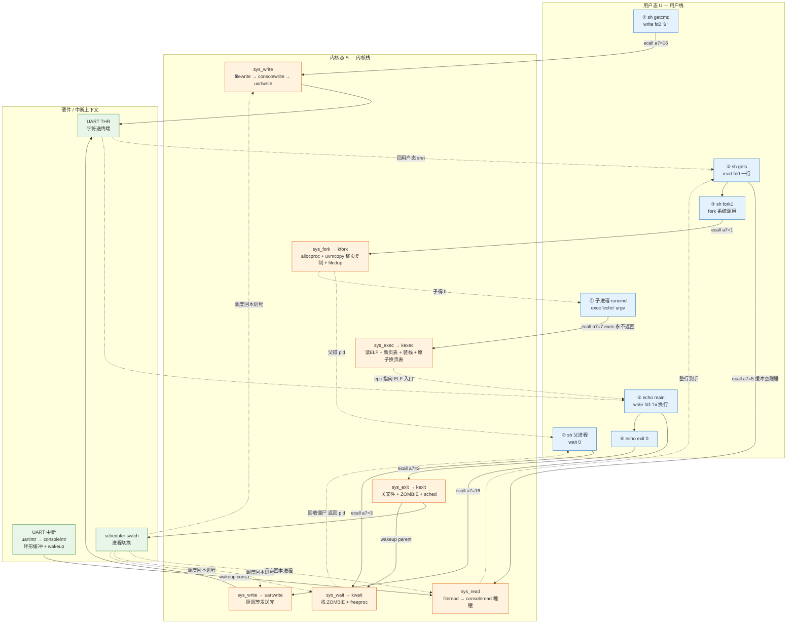
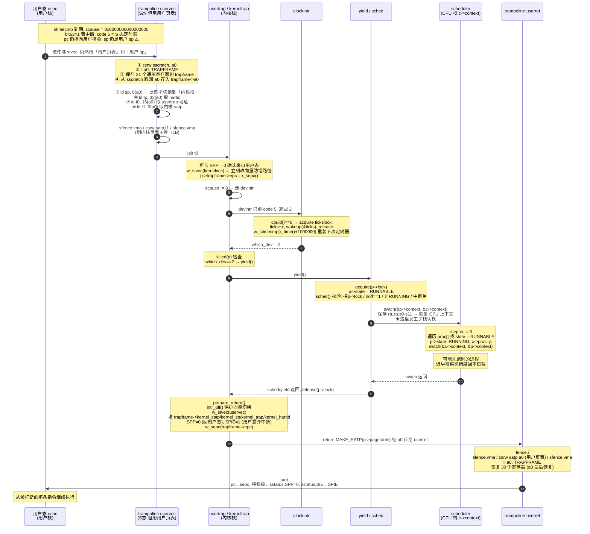

# lab0 · 交付三张图 — `echo hi` 的生命周期

> 追踪对象：shell 执行 `echo hi`
> 交付内容：图一 控制流图 / 图二 三本账快照 / 图三 时钟中断旅程
> 要求：纸上 **≥3 处你自己的批注**（疑问点 / 边界特例 / 启发点）
> 渲染：VS Code 里按 `Ctrl+Shift+V` 预览（Mermaid 需装预览扩展）；也可打印后手描

---

## 图一 · 全系统控制流图

`read → fork → exec → write → exit` 全链路，每阶段标注 **哪个栈 / 哪个特权级 / 是否持锁**。



### 阶段标注表（这是通过标准的①②，必须逐行标）

| # | 阶段 | 执行者 | 特权级 | 栈 | 持锁 | 关键代码 |
|---|---|---|---|---|---|---|
| ① | 打印提示符 | sh | U→S→U | 用户栈 → 内核栈（ecall 后） | `ftable.lock` 短暂持有 | `sh.c:137` / `file.c:filewrite` |
| ② | 读入一行 | sh | U→S 睡眠 | ecall 后切内核栈；睡在 `&cons.r` | `cons.lock`（读缓冲时持、睡眠前放） | `console.c:consoleread` |
| ②ᵃ | 键盘到达 | 中断 | S（用户页表→内核页表） | 内核栈（该进程的） | `cons.lock` | `console.c:consoleintr` |
| ③ | fork | sh | U→S→U ×2 | 父被子各一段，都用内核栈进 `kfork` | `np->lock`、`wait_lock`、`ftable.lock`（filedup） | `proc.c:kfork` |
| ③ᵇ | 复制地址空间 | 内核 | S | 内核栈 | 无（页表操作不加锁） | `vm.c:uvmcopy` |
| ④ | exec | 子 | U→S **不回** | 内核栈；成功后旧栈随旧页表一起释放 | `ftable.lock`、`ip->lock`、日志锁 | `exec.c:kexec` |
| ⑤ | 输出 hi | echo | U→S 睡眠 | 内核栈；`uartwrite` 睡在 `&tx_chan` | `tx_lock`（睡眠锁） | `uart.c:uartwrite` |
| ⑤ᵇ | 发送完成 | 中断 | S | 内核栈 | `tx_lock` | `uart.c:uartintr` |
| ⑥ | exit | echo | U→S **不回** | 内核栈 → `sched()` 切走 | `wait_lock`、`p->lock` | `proc.c:kexit` |
| ⑦ | wait | sh | U→S→U | 内核栈；可能在 `sleep_prepare(p)` 上睡 | `wait_lock`、`pp->lock` | `proc.c:kwait` |
| — | 进程切换 | 调度器 | S | **切到 CPU 的 scheduler 栈**（`c->context`） | 只持 `p->lock` | `proc.c:scheduler` / `swtch.S` |

### 必画的三个"边界跳转"

| 跳转 | 从 | 到 | 为什么关键 |
|---|---|---|---|
| `ecall` | U 态用户栈 | S 态，**pc=uservec，sp 还是用户 sp** | 硬件不切栈！`uservec` 靠 `sscratch` 和 `trapframe->kernel_sp` 才把 sp 换过来 |
| `sret` | S 态内核栈 | U 态用户栈 | 靠 `sstatus.SPP=0` + `sepc`，`prepare_return()` 准备 |
| `swtch` | 进程内核栈 | CPU 的 `scheduler` 栈 | 唯一"换栈"的地方，靠 `swtch` 保存 `ra/sp/s0-s11` |

---

## 图二 · 核心数据结构三本账（截面：exec 刚完毕）

### 账一 · 进程表 `proc[NPROC]`（NPROC = 64）

截面说明：`init` fork 出 `sh`，`sh` fork 出子进程，子进程的 `exec("echo")` **刚刚完成**。

| 槽位 | 进程 | state | chan | pid | parent | kstack | sz | pagetable | name |
|---|---|---|---|---|---|---|---|---|---|
| `proc[0]` | init | ZOMBIE·或SLEEPING | `p`（等下 wait） | 1 | — | 有 | sh 大小 | sh 页表 | `init` |
| `proc[1]` | **sh** | **SLEEPING** | **`&proc[1]`**（`kwait` 里 `sleep_prepare(p)`） | 2 | `&proc[0]` | 有 | echo-fork 时快照 | fork 时复制出的页表 | `sh` |
| `proc[2]` | **echo** | **RUNNING** | 0 | 3 | **`&proc[1]`** | 有 | **新程序的 sz** | **★刚换上的新页表** | `echo` |
| 其余 | — | UNUSED | 0 | — | — | 0 | 0 | 0 | — |

**`echo` 在 exec 完毕瞬间的关键字段（必标）**：

| 字段 | 值 | 含义 |
|---|---|---|
| `state` | `RUNNING` | 正在 CPU 上 |
| `kstack` | `KSTACK(idx)` = `TRAMPOLINE - (idx+1)*2*PGSIZE` | 内核栈，含上下各一页 guard |
| `pagetable` | 新页表 | **已原子替换（`p->pagetable = pagetable`）** |
| `sz` | `PGROUNDUP(prog_end) + 2*PGSIZE` | 程序段 + 1 页 guard + 1 页用户栈 |
| `trapframe->epc` | `elf.entry` | **echo 的入口**——`sret` 后从这里开始跑 |
| `trapframe->sp` | `sz` | 新用户栈顶（16 字节对齐） |
| `trapframe->a0` | `argc` | `main` 的第一个参数 |
| `trapframe->a1` | `argv 数组地址` | `main` 的第二个参数 |
| `trapframe->kernel_satp` | 内核页表 satp | 下次陷入时 uservec 用它 |
| `trapframe->kernel_sp` | `p->kstack + PGSIZE` | **下次陷入切到这个栈** |
| `trapframe->kernel_trap` | `usertrap` | 下次陷入跳这里 |
| `ofile[0..2]` | 都指向 console 的 `struct file` | 引用计数 = 3 |
| `context` | `ra = forkret` | 首次调度从这里开始 |
| `cwd` | `idup("/")` 得到的 inode | |

### 账二 · 页表（`echo` 刚换上的新用户页表）

`MAXVA = 1<<38 = 0x4000000000`，`PGSIZE = 4096`

```
  虚拟地址                        内容                  权限     PTE_U?   谁映射
  ─────────────────────────────────────────────────────────────────────────────
  0x4000000000  MAXVA  (越界红线)
  0x3FFFFFF000  TRAMPOLINE   ┌──────────────────┐   R|X       ✗     proc.c:proc_pagetable
                             │ trampoline 页     │   ← uservec / userret
                             │ (与内核页表指向   │     用户页表和内核页表
                             │  同一物理页!)     │     映射同一个物理页
  0x3FFFFFE000  TRAPFRAME    ├──────────────────┤   R|W       ✗     proc.c:proc_pagetable
                             │ trapframe 页      │   ← 每进程私有, 但**每个进程
                             │ (p->trapframe)    │     都映射到这个相同虚拟地址**
  ─────────────────────────  ├──────────────────┤  ← 以下按需生成
                             │        (空洞)     │
                             │                   │
     sz ───────────────────── ├──────────────────┤
     sz-0x1000                │ 用户栈 USERSTACK=1│   R|W|U     ✓     exec.c:kexec
                              │   sp = sz (16对齐)│
     sz-0x2000  ───────────── ├──────────────────┤
                              │ ★GUARD 页         │   R|W       ✗     exec.c:uvmclear
                              │  uvmclear 清掉 U  │     用户一碰就 fault
                              │                  │     = 栈溢出立即暴露
  prog_end ─────────────────  ├──────────────────┤
                              │ data / bss        │   R|W|U     ✓     exec.c:kexec
                              │ text              │   R|X|U     ✓     flags2perm
  0 ───────────────────────── └──────────────────┘

  内核页表 kernel_pagetable（同时存在，独立）：
     - 把 0x80000000..PHYSTOP 物理内存**恒等映射**（pa == va），内核才能直接解引用
     - 也在 TRAMPOLINE 处映射同一个 trampoline 页
     - 不含 TRAPFRAME（每个进程也不需要在核心里访问别人的 trapframe）
```

**必标的三条权限规则（通过标准④）**：

| 页 | 权限 | **有没有 `PTE_U`** | 理由 |
|---|---|---|---|
| trampoline | `PTE_R｜PTE_X` | **✗ 无** | 只有 S 态往返时用；用户态能执行它就能自己跳进内核 |
| trapframe | `PTE_R｜PTE_W` | **✗ 无** | 若用户可写 trapframe，就能改 `kernel_satp`/`epc` → 完全控制内核 |
| guard page | `PTE_R｜PTE_W` | **✗ 无** | 故意留着"物理页在、映射在、但用户不可访问"，让溢出变显式故障 |
| 用户栈/代码/数据 | 含 `PTE_U` | **✓ 有** | 用户态本来就要访问 |

> 注意 `proc_pagetable()` 里 trampoline 用 `PTE_R|PTE_X`、trapframe 用 `PTE_R|PTE_W`，**都没给 `PTE_U`**——这正是"特权边界"的体现。

### 账三 · 文件表 `ftable` 与引用链

```
  进程侧                     全局表                        底层对象
  ┌──────────────┐          ┌────────────────────┐
  │ echo->ofile[0]├────┐     │ ftable.lock        │
  │ echo->ofile[1]├──┐ ├────►│ ftable.file[0]     │   type   = FD_DEVICE
  │ echo->ofile[2]├┐ │ │     │  ref = 3 ★         │   readable/writable = 1/1
  └──────────────┘│ │ │     │  major = CONSOLE(1)│   off   = 0
  ┌──────────────┐│ │ │     │  ip    = 0         │   pipe  = 0
  │ sh->ofile[0..2]┘ ├────►│  ref = 3 ★         │
  └──────────────┘  └────►│  (都指向同一个 file)│
                            └─────────┬──────────┘
                                      │ devsw[major]
                                      ▼
                            ┌────────────────────┐
                            │ devsw[CONSOLE]     │
                            │  .read  = consoleread  │
                            │  .write = consolewrite │
                            └────────────────────┘

  FD_INODE 的引用链（对照）：
    ofile[fd] → struct file{type=FD_INODE, off} → ilock → struct inode{dev,inum,ref,type,nlink,size,addrs[]} → 磁盘块
       ▲ 注意 inode 有**自己的** ref 计数，与 struct file 的 ref 是两个层次
```

**必标的引用链要点（通过标准③）**：

| 计数 | 在哪 | 谁改 | 归零意味着 |
|---|---|---|---|
| `struct file.ref` | `ftable.file[i]` | `filealloc`(+1) / `filedup`(+1) / `fileclose`(-1) | 真正释放该 file 槽位（`type=FD_NONE`） |
| `struct inode.ref` | `inode` 缓存 | `idup`/`ilockput` | 从 inode 缓存淘汰 |
| `p->ofile[]` | 进程内 | `kfork` 复制并 `filedup`；`kexit` 逐个 `fileclose` | — |

> **本截图的关键点**：`sh` 和 `echo` 的 `ofile[0..2]` **指向同一个 `struct file`**，所以 `ref = 3`（console 被 3 个 fd 引用）。`echo` 退出时 `kexit` 会 `fileclose` 三次，`ref` 减到 0 才真正关闭。

---

## 图三 · 一次时钟中断的微观旅程

（从 `scause` 进 `usertrap` 到 `sret` 返回，寄存器现场 / 调度决策全程）



### 寄存器现场的三次"搬运"（这是图三的灵魂）

| # | 时刻 | 谁在搬 | 从哪 → 到哪 | 为什么必须 |
|---|---|---|---|---|
| 1 | 陷入瞬间 | **硬件** | 只动 `sepc`/`scause`/`sstatus`/`stval` | 通用寄存器一个都不保存！所以软件必须自己全存 |
| 2 | `uservec` 前几条 | **软件（汇编）** | 31 个通用寄存器 → `trapframe[]` | 用户态可能正在用任意一个寄存器 |
| 3 | `sret` 之前 | **软件（汇编）** | `trapframe[]` → 31 个通用寄存器 | 恢复到"什么都没发生过" |

**三个最容易被追问的细节**：

1. **`sscratch` 的角色互换**：陷入时 `sp` 还指向**用户栈**，而马上要往 `trapframe` 存 31 个寄存器——总得有个寄存器当基址。`a0` 是唯一敢动的，所以先 `csrw sscratch, a0` 把它藏起来，`li a0, TRAPFRAME` 腾出 a0 当基址，存完再从 `sscratch` 取回 a0 存进 `trapframe->a0`。**这解决了"没有空闲寄存器可用"的死结。**
2. **两次 `sfence.vma`**：切换 `satp` 前后各一次。前一次保证之前的内存操作完成，后一次清掉 TLB 里**旧的用户映射**。漏掉会访问到错误物理页——最隐蔽的 bug 之一。
3. **为什么 `w_stvec(kernelvec)` 要放在 `usertrap` 第一行**：此刻若发生内核态中断而 `stvec` 还指向 `uservec`，会把内核寄存器**覆盖进用户 trapframe**，并切到错误的内核栈 → 现场彻底错乱。所以进 `usertrap` 立刻改向量，`prepare_return()` 里再关中断改回来。

### 调度决策的两条岔路（对比着画）

| 场景 | 入口 | 处理 | 是否可能 `yield` |
|---|---|---|---|
| 中断发生在**用户态** | `uservec` → `usertrap` | `devintr` 返回 2 → **`yield()`** | ✅ 会（无条件） |
| 中断发生在**内核态** | `kernelvec` → `kerneltrap` | `devintr` 返回 2 且 `myproc() != 0` → `yield()` | ⚠️ 条件性（内核早期/CPU 0 空闲时 `myproc()==0`，不切） |

> 两条路都走 `same` 个 `clockintr`，但 `kerneltrap` 结尾要 `w_sepc/w_sstatus` **还原**（因为 `yield()` 期间可能又来了新陷阱），`usertrap` 则是重新 `prepare_return()`。这个差异值得作为批注点。

---

## 我自己的批注（≥3 处，请替换成你自己的疑问/发现）

> ⚠️ **这三条是我的候选，你必须换成/补充你自己真正想过的**。验收会现场追问，背下来的没用。

1. **【边界特例】** `uservec` 里 `sp` 从用户栈换到内核栈之前，中间有约 30 条 `sd` 指令是跑在**用户栈指针**上的——此时如果来一次**嵌套中断**会怎样？（答：M 态 `mstatus.MIE` 已关，S 态 `sstatus.SIE` 在陷入时被硬件清零，所以此窗口是安全的。这解释了为什么 `usertrap` 里要等 `epc += 4` 做完才 `intr_on()`。）
2. **【设计对比】** `kexec` 是"**先造新页表、最后一步才原子替换**"，而 `kfork` 是"**边复制边填子进程页表**"。为什么 exec 必须原子、fork 却不必？（答：exec 失败后**旧程序还要继续运行并报错**；fork 失败时子进程本就未诞生，`freeproc` 直接丢弃即可。）
3. **【开销观察】** 第③步 `uvmcopy` 在 `echo` 之前把父进程**每一页都真复制**，而 child 紧接着第④步就 `exec` 把整个地址空间换掉——**这批复制 100% 是浪费**。这正好是 lab5 写时复制（COW）的动机；我的 `LAB5_REFCNT_SCHEME = 1`（全局数组）和 `LAB5_COW_BUDGET = 191` 就是在给这个优化定参数。
4. **【疑似 bug / 存疑】** `sh.c` 的 `runcmd` 在 `exec` 失败后走到末尾 `exit(0)`，即"exec 失败的子进程向父进程汇报成功"。我觉得更合理的应是 `exit(1)`，但参考实现如此，没敢改。
5. **【个性化关联】** 第⑤步 `uartwrite` 会睡眠，而我的 lab1 `uartputc_sync` 是忙等版——两者是同一个硬件、两种策略。lab2 要我把"轮询"升级成"中断驱动"，`LAB2_BUF_SEMANTICS=1`（字符流）意味着**不用等到回车就该唤醒读者**。

---

## 对照通过标准自查

| 通过标准 | 本文件对应内容 | 自查 |
|---|---|---|
| ① 控制流全链路闭环 | 图一 flowchart（①→⑦ 全部有向边闭合）+ 阶段标注表 | ☐ |
| ② 关键跳转标注栈归属与特权级 | 图一"必画的三个边界跳转"表 + 标注表的"栈/特权级"两列 | ☐ |
| ③ 三本账字段完整、引用链清晰 | 图二 账一字段表 / 账三引用链图 + 计数表 | ☐ |
| ④ trampoline/trapframe 边界与权限位正确 | 图二 账二 地址空间 ASCII 图 + "三条权限规则"表（**核心：两页都没有 `PTE_U`**） | ☐ |
| ⑤ 时钟中断：现场保护→调度→sret 完整 | 图三 sequence + "寄存器现场三次搬运"表 | ☐ |
| ≥3 处自己的批注 | 上面的"我自己的批注"（**必须改成你自己的**） | ☐ |

---

## 附：把本文件导出为图片/PDF

```bash
# 方式一：VS Code 预览后打印成 PDF
#   打开本文件 → Ctrl+Shift+V → Ctrl+P → 选区另存为 PDF

# 方式二：Mermaid CLI 导出 PNG
npm install -g @mermaid-js/mermaid-cli
mmdc -i lab0-三张图.md -o 三张图.png
```
