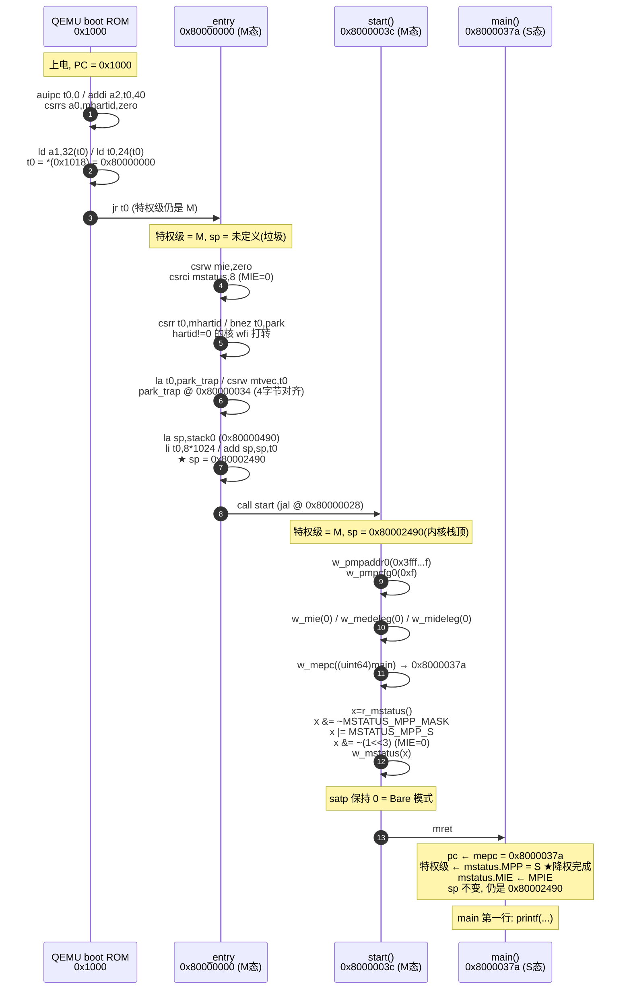

# lab1 设计笔记 · 启动与串口输出

> 学号 2024302111423 ｜ 姓名 李思翰 ｜ 实验 1（第 2–3 周）
>
> **使用说明**：本文件是 design notes 骨架 + 已验证的技术事实。
> 所有地址、字节数均来自本机实测，非估计值。

---

## 0. 交付物清单

| # | 交付物                                              | 状态      |
| - | --------------------------------------------------- | --------- |
| 1 | `kernel/entry.S`                                  | ✅ 已实现 |
| 2 | `kernel/start.c`                                  | ✅ 已实现 |
| 3 | `kernel/console.c`                                | ✅ 已实现 |
| 4 | `kernel/printf.c`                                 | ✅ 已实现 |
| 5 | `kernel/main.c`                                   | ✅ 已实现 |
| 6 | `expect_banner.txt`（工程根目录，72 字节）        | ✅ 已生成 |
| 7 | **本设计笔记**                                | 🔄 进行中 |
| 8 | Git 标签`lab1-start` / `lab1-submit` + 归档 zip | 🔄 待补   |
| 9 | lab0 三张图（`lab0/`）                            | ✅ 已备   |

**未改动的预置文件**（`git diff` 应为空）：`kernel/kernel.ld`、`kernel/riscv.h`、`kernel/memlayout.h`、`kernel/types.h`、`Makefile`、`kernel/course_sid.h`。

---

## 1. 我的个性化参数

唯一来源：`kernel/course_sid.h`（自动生成，禁止修改）

| 参数                     | 值                          | 派生公式               | 在本实验中的作用                         |
| ------------------------ | --------------------------- | ---------------------- | ---------------------------------------- |
| `COURSE_SID`           | `2024302111423`           | —                     | banner 中的学号字段                      |
| `LAB1_BANNER_PROTOCOL` | **1**                 | `sid % 3`            | **每字节后跟 `.`**（含换行字节） |
| `LAB1_STACK_KB`        | **8**                 | `4 × (1 + sid % 3)` | 内核栈容量 = 8192 字节                   |
| `sid % 97`             | **0x13**（十进制 19） | —                     | banner 的 mod97 十六进制字段             |
| 节流周期                 | **31**                | `16 + sid % 16`      | 每输出 31 字节插一次 nop 空转            |

**预期输出**（协议 1，末尾换行后仍有一个 `.`）：

```
O.S.L.A.B.1. .s.i.d.=.2.0.2.4.3.0.2.1.1.1.4.2.3. .m.o.d.9.7.=.0.x.1.3.
.
```

共 72 字节。

---

## 2. 思考题（实验说明书 §2）

### 题 1：上电后 PC=0x1000，`-bios none` 意味着什么？内核为何必须链接到 0x80000000 而非 0x0？

**实测证据**（`-d in_asm` 抓的真实执行序列）：

```
0x00001000:  auipc  t0,0                 # ← 上电第一条指令
0x00001004:  addi   a2,t0,40             # a2 = 0x1028，传给内核的 FDT 指针
0x00001008:  csrrs  a0,mhartid,zero      # a0 = hartid
0x0000100c:  ld     a1,32(t0)
0x00001010:  ld     t0,24(t0)            # t0 = *(0x1018)，QEMU 写入的内核入口
0x00001014:  jr     t0                   # 跳转
----------------
0x80000000:  csrrw  zero,mie,zero        # ← 我的 _entry 第一条指令
```

**实测地址地图**（QEMU monitor `info mtree -f`）：

```
0x0000000000001000-0x000000000000ffff  rom   riscv_virt_board.mrom   ← boot ROM
0x0000000002000000-0x0000000002003fff  i/o   riscv.aclint.swi        ← CLINT
0x000000000c000000-0x000000000c5fffff  i/o   riscv.sifive.plic       ← PLIC
0x0000000010000000-0x0000000010000007  i/o   serial                  ← UART0
0x0000000010001000-0x00000000100011ff  i/o   virtio-mmio             ← 磁盘
0x0000000020000000-0x0000000021ffffff  romd  virt.flash0
0x0000000080000000-0x0000000087ffffff  ram   riscv_virt_board.ram    ← ★真正的 RAM（128 MB）
```

**答**：

- **PC = 0x1000** 是 QEMU virt 机器的复位向量，落在 ROM（不是 RAM）。这 6 条指令从固定地址 `0x1018` 读出内核入口地址，然后 `jr` 过去。
- **`-bios none`** 表示**不加载任何固件**（正常情况下会加载 OpenSBI）。
  - 正常情况：OpenSBI 以 **M 态**启动，做完平台初始化后降权跳进内核 → **内核从 S 态开始**。
  - `-bios none`：**没有 M 态固件**，所以内核自己以 **M 态**上电，**必须自己做 M→S 切换**。
  - **这正是 lab1 存在的理由**——`entry.S` + `start.c` 干的就是本该由 OpenSBI 干的活。
- **为什么必须链到 0x80000000**：`0x0`–`0x7fffffff` 区间**根本不是 RAM**——0x1000 是 ROM、0x2000000 是 ACLINT、0xc000000 是 PLIC、0x10000000 是串口。把内核链接到 `0x0` 等于把代码和数据塞进设备寄存器区域，**装载和取指都会失败**。RAM 从 **0x80000000** 开始（`kernel.ld` 的 `BASE_ADDRESS`）。

### 题 2：entry.S 里每条指令的存在理由 + 栈 + 从核 park + mtvec 对齐

见 §5 逐行注解表。三个要点先列：

- **初始内核栈**：`stack0`，8 KB（`LAB1_STACK_KB × 1024`），放在 `.bss`（不占镜像体积）。
- **从核必须 park**：多核时所有 hart 都从 `0x80000000` 执行**同一段代码**；不区分就会同时初始化 `stack0`、同时写 console 的静态计数器 → 数据竞争。
- **`mtvec` 对齐**：低 2 位是模式位，写入地址必须 **4 字节对齐**；不满足时硬件**静默丢弃**整个写入 → 任何异常都跳地址 0。

> **【你来写】**：用自己的话补一句"为什么复位后 MIE 本来就是 0，还要显式再关一次"。

### 题 3：进入 S 态前必须完成的配置清单

在 `start()` 里，顺序即依赖关系：

| 序 | 配置                      | 值                   | 若缺失/写错的后果                                                               |
| -- | ------------------------- | -------------------- | ------------------------------------------------------------------------------- |
| 1  | `pmpaddr0`              | `0x3fffffffffffff` | **全程黑屏**：`mret` 后首条取指 instruction access fault（`cause=1`） |
| 2  | `pmpcfg0`               | `0xf`              | 同上（A=NAPOT, R=W=X=1, L=0）                                                   |
| 3  | `mie`                   | 0                    | 早期被中断打断，跳向未初始化的向量                                              |
| 4  | `medeleg` / `mideleg` | 0                    | 若委托了但 S 态`stvec` 还是 0 → 异常跳地址 0                                 |
| 5  | `mepc`                  | `(uint64)main`     | `mret` 后跑到错误地址                                                         |
| 6  | `mstatus.MPP`           | `MSTATUS_MPP_S`    | `mret` 后仍留在 M 态（没完成降权）                                            |
| 7  | `mstatus.MIE`           | 0                    | 同上（`MPIE` 复位默认 0，显式写是防御性）                                     |
| 8  | `satp`                  | 保持 0（Bare）       | —                                                                              |

**PMP 字段涵义**：NAPOT 编码用"低位连续 1 的个数"表示范围大小；`0x3fff...ff` 尾部全 1 = 覆盖到地址空间顶端。`pmpcfg0 = 0xf` → bit0-1 `A=01`(NAPOT)、bit2 `X=1`、bit3 `W=1`、bit4 `R=1`；bit7 `L=0`（不锁定，否则后续无法修改）。

### 题 4：启动阶段 `satp` 选 Bare 还是恒等映射？

**选 Bare 模式（`satp = 0`）**。

论证：

1. **lab1 没有页表**——`vm.c` 在 lab3 才写，此刻没有可填 `satp` 的根页表。
2. **启动早期用物理地址直连最简单**：`UART0 = 0x10000000` 直接可写，不需要任何地址翻译。恒等映射要先分配页、建三级页表、再打开分页——把"还没调试好的内存管理"用在了"还没验证过的启动路径"上。
3. **Bare 的代价可接受**：没有地址空间隔离，但 lab1 根本没有用户态进程。
4. **lab2 之后才需要**：真正的隔离由 lab3 的 SV39 页表引入。届时 `satp` 会被设成 `MAKE_SATP(pagetable)`。

代码上体现为：**没有调用 `w_satp()`**，保持复位默认值 0。

### 题 5：UART 16550 轮询输出协议

| 项                    | 值                                                                  |
| --------------------- | ------------------------------------------------------------------- |
| 硬件基地址            | `UART0 = 0x10000000`（来自 `memlayout.h`，全班统一）            |
| THR（发送保持寄存器） | 偏移**0**，**写入**字符                                 |
| LSR（线路状态寄存器） | 偏移**5**，**读取**状态                                 |
| 判据                  | `LSR` 的 **bit5 = THRE**（Transmit Holding Register Empty） |
| 写入条件              | **`LSR & (1<<5)` 为真时**才能写 THR；否则字符被静默丢弃     |

**为什么用 THRE（bit5）而不是 TEMT（bit6）**：bit6 表示"发送器完全空"，更严格但更慢；THR 空了就已经可以装下一个字节，够用。

**为什么不设超时重试**：启动期间没有时钟中断，无法睡眠——**忙等是唯一可靠行为**。

---

## 3. 启动时序图（上电 → `main` 第一行）



### 特权级与寄存器的变化（时序图必须标注的两条线）

| 阶段              | 特权级      | sp                   | pc         | 备注                             |
| ----------------- | ----------- | -------------------- | ---------- | -------------------------------- |
| 上电              | M           | 垃圾                 | 0x1000     | ROM                              |
| `jr t0` 后      | M           | 垃圾                 | 0x80000000 | 进了`_entry`，**还没栈** |
| 建栈后            | M           | **0x80002490** | 0x80000028 | stack0+8KB                       |
| `call start` 后 | M           | 0x80002490           | 0x8000003c |                                  |
| `mret` 后       | **S** | 0x80002490           | 0x8000037a | **唯一一次特权级跃迁**     |
| `main` 内       | S           | 0x80002490           | 0x8000037a | 之后不再变                       |

---

## 4. 内核内存空间布局图

物理地址空间（QEMU virt，实测）：

```
  0x00001000  ┌──────────────┐
              │  boot ROM    │  6 条指令，跳向 0x80000000
  0x0000ffff  └──────────────┘
              ⋮   (空洞)
  0x02000000  ┌──────────────┐
              │  ACLINT      │  定时器/软件中断（lab2 用）
  0x0c000000  ┌──────────────┐
              │  PLIC        │  外部中断控制器（lab2 用）
  0x10000000  ┌──────────────┐
              │  UART0 ★     │  ← console.c 里 UART_BASE[LSR/THR] 访问这里
  0x10001000  ├──────────────┤
              │  virtio mmio │  磁盘（lab6 用）
              ⋮   (空洞)
  0x80000000  ┌══════════════┐ ← RAM 起点 = BASE_ADDRESS = KERNBASE
              │  .text  924B │  _entry@0x80000000  park@0x2c  park_trap@0x34
              │              │  start@0x3c  main@0x37a
  0x800003a0  ├──────────────┤
              │  .rodata 233B│  字符串常量 "OSLAB1 sid=%ld mod97=0x%x\n" 等
  0x80000490  ├──────────────┤ ← .bss 起点
              │  stack0      │  ★ 我的内核栈，8192 字节
              │  (8192 B)    │
  0x80002490  ├──────────────┤ ← ★ sp 初值 = stack0 + 8KB（栈顶）
              │  static int n│  4 字节（console.c 里 putchar 的节流计数器）
  0x80002494  ├──────────────┤ ← kernel_end（.bss 共 8196 B = 8192 + 4）
              ⋮              ⋮
              │  可用 RAM    │  lab3 的 kalloc 从这里开始分配
  0x88000000  └══════════════┘ PHYSTOP = KERNBASE + 128MB（RAM 上界）
```

**镜像实测数据**：

| 段          | 大小             | VMA = LMA          | 对齐   |
| ----------- | ---------------- | ------------------ | ------ |
| `.text`   | 924 B            | 0x0000000080000000 | 2²=4  |
| `.rodata` | 233 B            | 0x00000000800003a0 | 2³=8  |
| `.bss`    | **8196 B** | 0x0000000080000490 | 2⁴=16 |

- `ELF Entry = 0x80000000`，`LOAD` 段 `vaddr = 0x80000000`、`memsz = 0x2494`、`RWE`
- **链接地址 == 加载地址**（VMA == LMA）→ 因为 `-bios none` 下 QEMU 按 ELF program header 直接装载，不需要位置无关代码
- **`.bss` 不占镜像文件**：`filesz = 0x489`，但 `memsz = 0x2494`——差的那 8196 字节（栈）只在内存里存在
- **`.bss` 8196 = 8192（stack0）+ 4（`static int n`）** —— 这个 4 字节正好对应 `putchar` 里的节流计数器

**栈的对齐**：`.bss` 段对齐 16 字节 → `stack0` 16 对齐 → `sp = stack0 + 8192` 也 16 对齐，满足 RISC-V ABI。

> **【你来写】**：画一张比例尺略有夸张的手绘图（栈只占 8KB 但可以画大点），标注 `sp` 的初始位置和"栈向低地址增长"的箭头。

---

## 5. `kernel/entry.S` 逐行注解

> 验收会**现场抽查逐条解读**，下表必须能脱稿讲。

| 地址/行                           | 指令                           | 为什么必须有这条                                                                           |
| --------------------------------- | ------------------------------ | ------------------------------------------------------------------------------------------ |
| `_entry:`                       | —                             | 链接脚本`ENTRY(_entry)` 指定的入口，消掉 `cannot find entry symbol` 警告               |
| `csrw mie,zero`                 | M 态中断使能全清               | 中断向量还没装，此窗口期被打断会跳到垃圾地址                                               |
| `csrci mstatus,8`               | 清`mstatus` 的 bit3（MIE=0） | 关总中断开关；显式写出意图，不依赖"复位默认值恰好正确"                                     |
| `csrr t0,mhartid`               | 读硬件线程号                   | 多核时所有 hart 都从这里执行，必须区分                                                     |
| `bnez t0,park`                  | 非 0 号核跳 park               | 否则多核会同时初始化`stack0`、同时写 console 计数器 → 数据竞争                          |
| `la t0,park_trap`               | 取标号地址                     | 装 M 态陷阱向量                                                                            |
| `csrw mtvec,t0`                 | 写`mtvec`                    | 不装的话意外异常跳无效地址 → 跑飞且无日志；装后掉进`park_trap`，`-d int` 能立刻定位   |
| `.balign 4`（`park_trap` 前） | 4 字节对齐                     | `mtvec` 低 2 位是模式位；未对齐时硬件**静默丢弃**写入 → 任何异常跳地址 0          |
| `la sp,stack0`                  | 栈底                           | C 语言每次调用/局部变量都要栈；跑到`start()` 前必须建好，否则第一条 C 指令就崩           |
| `li t0,LAB1_STACK_KB*1024`      | 容量 8192                      | **引用 `course_sid.h`，不硬编码**——个性化参数唯一来源                            |
| `add sp,sp,t0`                  | `sp = stack0 + 8192`         | RISC-V 栈**向低地址增长**，所以 `sp` 初值必须是栈的**最高地址**              |
| `call start`                    | 进 C                           | `start()` 永不返回（内部 `mret` 走了），所以不需要有效 `ra`                          |
| `park: wfi; j park`             | 从核等待                       | `wfi` 低功耗等待，比 `j .` 空转省电；被中断唤醒后继续等                                |
| `.balign 4`                     | 对齐                           | 见上                                                                                       |
| `park_trap: wfi; j park_trap`   | M 态兜底                       | 意外异常停在这里打转，配合`-d int` 定位                                                  |
| `.section .bss`                 | 换段                           | `.bss` 是 `NOBITS`，**不占镜像体积**（实测 `.bss` 8196B 但 filesz 只有 0x489） |
| `.align 4`                      | **16 字节对齐**          | RISC-V 里`.align N` 是 2ᴺ 字节，`.balign N` 才是字节数。栈必须 16 对齐满足 ABI        |
| `.globl stack0`                 | 导出符号                       | 让链接可见；实测落在`0x80000490`                                                         |
| `.space LAB1_STACK_KB*1024`     | 预留 8192 字节                 | 不初始化，加载时为零                                                                       |

**实测反汇编对照**（验证代码确实这么编）：

```asm
8000001c:  auipc sp,0x0
80000020:  addi  sp,sp,1140      # sp = 0x80000490 = stack0
80000024:  lui   t0,0x2          # t0 = 8192 = 8 * 1024
80000026:  add   sp,sp,t0        # sp = 0x80002490 ★
80000028:  jal   8000003c <start>
```

---

## 6. `kernel/start.c` 注解

见 §2 题 3 的配置清单表。补充代码层面的两个设计决定：

| 决定                              | 理由                                                                                           |
| --------------------------------- | ---------------------------------------------------------------------------------------------- |
| 用"读-改-写"而非直接赋`mstatus` | `mstatus` 里还有 `FS`/`XS`/`SUM`/`MPRV` 等位不能碰；只清/置需要的位是最小改动        |
| `x &= ~(1L << 3)` 手写而非用宏  | `riscv.h` 只提供了 `MSTATUS_MPP_*` 三个宏，**没有 `MSTATUS_MIE`**，所以显式写 bit3 |
| `asm volatile("mret")`          | C 无法表达`mret`；`volatile` 防止优化器把"没有副作用"的整行删掉                            |
| 函数无`return`                  | `mret` 之后永远不回这里（pc 已变成 `main`）                                                |

---

## 7. `kernel/console.c` 设计规范

### 7.1 三层职责（验收"定位题"逐层问）

```
line_putc(c)      协议层：施加个人行协议（协议 1 = 每字节后加 '.'）
    ↓
putchar(c)        节流层：每 31 字节插一次 nop 空转
    ↓
uartputc_sync(c)  硬件层：忙等 LSR.THRE，写 THR     ← 唯一碰硬件的一层
```

### 7.2 好版规范（对照说明书附录 A 的"好版"格式，我按自己的实现写）

```c
void uartputc_sync(char c);
- 硬件地址：基地址 UART0 = 0x10000000（memlayout.h）；THR 偏移 0，LSR 偏移 5
- 状态机：循环忙等 LSR bit5（THRE）变为 1 后向 THR 写入字符
- 超时策略：本实验启动阶段不设超时重试（启动期间无时钟中断，忙等是唯一可靠行为）
- 协议分层：本函数仅负责单字节硬件发射；个性化字符修饰在 line_putc 中包装
- 并发假设：启动早期仅由单核单上下文调用，声明不可重入
- volatile 约束：UART_BASE 必须声明为 volatile unsigned char *，
  否则编译器可能把"读一次就不变"的假设套到状态轮询上，优化掉循环
```

### 7.3 节流实现的关键点

```c
#define THROTTLE_PERIOD (16 + COURSE_SID % 16)   /* 我的值 = 31，绝无硬编码 */
static int n;                                    /* 必须 static：跨调用保持 */
for (volatile int i = 0; i < THROTTLE_PERIOD; i++)
  asm volatile("nop");                           /* volatile 防优化删除 */
```

- **`static int n` 为什么必须 static**：计数器要跨多次调用保持；普通局部变量每次重新分配，计数永远停在 1。
- **两处 `volatile` 各自的作用**：
  - `volatile int i` —— 循环无副作用，`-O` 下会被整个删掉 → 节流失效
  - `UART_BASE` 的 `volatile` —— 硬件寄存器会被外部修改，编译器看不到
- **节流的观察效果**：实测 1162 字节输出下触发约 37 次空转，无可见差异（设计意图是降低输出速率，不是产生可见现象）。

---

## 8. `kernel/printf.c` 格式化规范（★说明书要求"预先确立"）

说明书写着：**"对 `%d` 负数格式化、`%x` 前导零等细节，必须在设计笔记中预先确立规范"**。以下是我的规范：

| 格式        | 规范                                | 实现要点                                                        | 实测值                                               |
| ----------- | ----------------------------------- | --------------------------------------------------------------- | ---------------------------------------------------- |
| `%d` 正数 | 十进制无前导零                      | `printnum` 取余倒序                                           | `0` → `0`；`2147483647` → `2147483647`     |
| `%d` 零   | 输出单个`0`                       | **特判**：`while (x>0)` 在 x=0 时一次都不执行会输出空串 | `0` → `0`                                       |
| `%d` 负数 | 先输出`-`，再取相反数按无符号处理 | C 对负数的`/` `%` 结果依实现，先取反避免歧义                | `-1` → `-1`；`-2147483648` → `-2147483648` |
| `%x`      | **小写 `0x` 无前导零**      | `printnum` 天然只产出有效位，无补零路径                       | `0xABC` → `abc`；`0` → `0`                 |
| `%x` 大数 | 不截断（64 位）                     | `%lx` 走 `unsigned long` 分支                               | `0xdeadbeefcafe` → `deadbeefcafe`               |
| `%s` 空串 | 输出空（零字节）                    | `while (*s)` 直接不进循环                                     | `""` → 空                                         |
| `%s` NULL | 输出`(null)`                      | **特判**：裸机解引用地址 0 会崩内核                       | `(char*)0` → `(null)`                           |
| `%s` 超长 | 不截断、不崩溃                      | 逐字符输出，无缓冲上限                                          | 71 字符串完整输出                                    |
| `%p`      | `0x` + **固定 16 位补零**   | 与`%x` **不同**，单独函数 `printptr`                  | `0x1234` → `0x0000000000001234`                 |
| `%c`      | 单字符                              | **`va_arg(ap,int)` 再转 char**（C 的默认整型提升）      | `'Z'` → `Z`                                     |
| `%%`      | 一个字面`%`                       | —                                                              | `%` → `%`                                       |
| 未知格式    | **原样输出，不崩溃**          | `default` 分支输出 `%` 和该字符                             | `%q` → `%q`                                     |
| 无格式串    | 输出空行                            | 循环体不进                                                      | `""` → 空                                         |

**两个关键设计决定**：

1. **为什么 `%p` 和 `%x` 分开实现**：规范要求"`0x` 小写、无前导零"（`0x13` 而不是 `0x000...0013`）。**补零的 `%p` 会直接判错**，所以 banner 必须用 `%x`。
2. **为什么未知格式"原样输出"而不是 panic**：lab1 是裸机，崩了就黑屏，连错误信息都看不到。原样输出让"不支持的格式"变成**可见但无害**的行为——这正是"printf 边界测试无崩溃"这条核心通过线的设计依据。

**已知边界缺陷（主动记录）**：`printint` 里 `-xx` 在 `xx == LLONG_MIN` 时会**溢出**（补码最小值取反不可表示）。原始 xv6 也有此问题。lab1 的边界测试范围（`INT_MIN` = -2147483648）在 `long long` 上是安全的，未触发。

**变参类型必须精确**：`%d` 用 `va_arg(ap,int)`、`%ld` 用 `va_arg(ap,long)`、`%c` 用 `va_arg(ap,int)`，类型不匹配是 UB。RISC-V64 上 `int`/`long` 都在 64 位寄存器里传递，但仍不能混用。

---

## 9. 测试记录

### 9.1 printf 边界自测（实测 23/23 PASS）

**方法**：在**树的副本**上替换 `kernel/main.c` 为测试版本（**不能留在提交树**，否则破坏 banner 逐字节比对与幂等性），`make` → 跑 QEMU 抓串口 → 删掉协议 1 的转义点还原明文 → 逐项比对。

**测试项与实测结果**（全部 PASS）：

| 类别     | 用例                                                  | 实测输出                                             |
| -------- | ----------------------------------------------------- | ---------------------------------------------------- |
| 整数     | `0` / `-1` / `INT_MIN` / `INT_MAX` / `-999` | `0` `-1` `-2147483648` `2147483647` `-999` |
| 十六进制 | `0` / `0x13` / `0xdeadbeef` / `0xABC`         | `0` `13` `deadbeef` `abc`                    |
| 字符串   | 空串 / NULL / 7字符 / 71字符                          |  `(null)` `abcdefg` 完整 71 字符                 |
| 64 位    | `%ld` 学号 / `%x` mod97 / `%lx`                 | `2024302111423` / `0x13` / `deadbeefcafe`      |
| 其他     | `%c` / `%%` / `%q` / 空格式 / `%p`            | `Z` / `%` / `%q` / 空 / `0x0000000000001234` |
| 混合     | `%d,%x,%s` / 无换行结尾连续的两次调用               | `-42,ab,ok` / `7` 与 `8` 正确拼接              |

**同时验证**：`-d int` 日志 **0 行**（全程零异常/中断报错）。

### 9.2 Autograder 验收自测（3/3 PASS）

```
[PASS:banner_match] banner 逐字节一致
[PASS:idempotent] 两次启动输出逐字节一致
[PASS:d_int] 全程无内核异常/中断报错
[INFO:throttle] 源码包含 COURSE_SID 节流引用
RESULT: 3/3
```

### 9.3 分阶段编译检查点

| 检查点                                                  | 预期                                                                                                            | 实测                                       |
| ------------------------------------------------------- | --------------------------------------------------------------------------------------------------------------- | ------------------------------------------ |
| 只写`entry.S`，`start/console/printf/main` 为空骨架 | 编译通过 +`cannot find entry symbol _entry` 警告                                                              | ✅ 警告出现（说明书 §4 预告的"设计信号"） |
| 写完`entry.S` + `start.c`                           | `_entry` 警告消失；链接因缺 `main`/`printf`/`line_putc` 报 undefined reference                          | ✅ 符合预期                                |
| 五个文件全部写完                                        | 链接成功，仅剩`LOAD segment with RWX permissions` 警告（预置 `kernel.ld` 把各段放进同一 LOAD 段导致，无害） | ✅`make rc=0`                            |

---

## 10. 我自己的批注与存疑点

> **【你来写】** 下面几条是我给的方向，请换成/补充你自己真正想过的问题。验收会拿这个当谈资。

1. **【边界特例】** `entry.S` 里 `.align 4` 是 16 字节对齐、`.balign 4` 是 4 字节对齐——同样写 `4` 结果差 4 倍。这是 GNU as 的两种指令语义不同，我一开始搞混了。
2. **【存疑】** 复位后 `mstatus.MIE` 本来就是 0，`csrci mstatus,8` 是否是冗余？（我的结论：功能上冗余，但作为"显式意图"保留，且不依赖硬件复位值。）
3. **【观察】** `.bss` = 8196 = 8192（栈）+ 4（`putchar` 的 `static int n`）——一个 `static` 局部变量确实落进了 `.bss`，这验证了"`static` 让变量跨调用存活"的机制。
4. **【对齐依赖】** `sp = stack0 + 8192` 能 16 字节对齐，是因为 8192 是 16 的倍数**且** `stack0` 本身 16 对齐（`.bss` 段对齐为 16）。如果 `LAB1_STACK_KB` 派生出一个非 16 倍数的字节数，`sp` 就会错位——这是"栈大小必须与 `course_sid.h` 强一致"之外的另一个隐含约束。
5. **【与 lab2 的接口】** 我写的 `uartputc_sync` 是忙等版；lab2 要升级成"中断驱动 + 睡眠"版（对照参考树的 `uartwrite`/`uartintr`）。同一个硬件、两种策略：忙等不睡眠（可在中断上下文调用）vs 睡眠（必须进程上下文）。这个对比是 lab2 的起点。

---

## 11. 环境陷阱备忘（说明书附录 B）

| 陷阱                                    | 症状                  | 排查                                                     | 后果                     |
| --------------------------------------- | --------------------- | -------------------------------------------------------- | ------------------------ |
| **缺 PMP 两行**                   | 全程黑屏，无任何字符  | `-d int` 日志首行 `cause=1`                          | S 态首条取指 fault       |
| **`mtvec` 未 4 字节对齐**       | 任何异常都跳地址 0    | 检查`park_trap` 前是否有 `.balign 4`                 | 写入被**静默丢弃** |
| 误改预置文件                            | 非预期的底层编译错误  | `git diff` 比对 `kernel.ld`/`riscv.h`/`Makefile` | 接口规范被破坏           |
| Windows 记事本保存`expect_banner.txt` | banner 逐字节比对失败 | `cat -A` 看到 `^M$`                                  | `\n` 被换成 `\r\n`   |

**无 gdb 替代调试三板斧**（《07-学生无gdb调试手册》）：

```bash
# 1) 看异常
qemu-system-riscv64 -machine virt -bios none -kernel kernel/kernel -nographic -d int -D int.log &
QPID=$!; sleep 4; kill $QPID; head -3 int.log

# 2) 看执行流（我验证上电首条指令用的就是这个）
qemu-system-riscv64 ... -d in_asm -D asm.log &
QPID=$!; sleep 2; kill $QPID; head -12 asm.log

# 3) 串口监控
python3 tools/monpeek.py

# 退出 QEMU：Ctrl-a 松开，再按 x
```

---

## 12. 验收三题自查（脱稿讲一遍）

| 题                                                             | 一句话答案                                                                                                                                                                                                                                                                     | 能脱稿？ |
| -------------------------------------------------------------- | ------------------------------------------------------------------------------------------------------------------------------------------------------------------------------------------------------------------------------------------------------------------------------ | -------- |
| **机理题**：上电首条指令位置 / 为什么链到 0x80000000     | 首条在**0x1000**（boot ROM，6 条指令从 0x1018 取入口后 `jr`）；内核必须链到 **0x80000000**，因为 `0x0`–`0x7fffffff` 全是 ROM/MMIO（0x1000 ROM、0x2000000 CLINT、0xc000000 PLIC、0x10000000 UART），**不是 RAM**                                       | ☐       |
| **个性化题**：个人行协议函数与转义逻辑                   | `console.c` 的 **`line_putc()`**；`#if LAB1_BANNER_PROTOCOL == 1` → 每字节后 `putchar('.')`；末尾孤立的 `.` 来自 `\n` **也是字节**，走同一路径                                                                                                        | ☐       |
| **定位题**：栈在哪 / sp 与哪个文件强一致 / 删 PMP 会怎样 | 栈在**`entry.S` 的 `.bss` 段 `stack0`**，实测 `0x80000490`；`sp = stack0 + LAB1_STACK_KB×1024 = 0x80002490`，**必须与 `kernel/course_sid.h` 强一致**；删 PMP → `mret` 后首条取指 **instruction access fault（cause=1）**，**全程黑屏** | ☐       |
| **lab0 图纸抽查**                                        | 见`lab0/lab0-三张图.md` + 两张 PNG                                                                                                                                                                                                                                           | ☐       |
